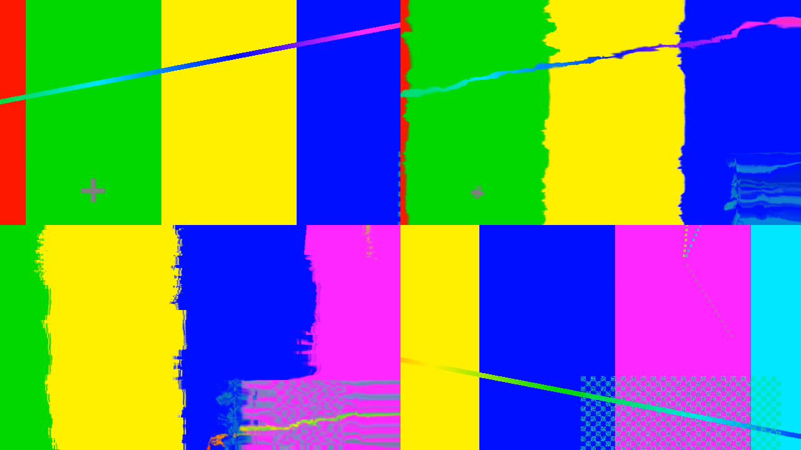
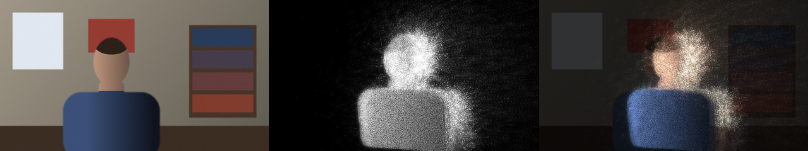

# Datamosh for OBS

A datamosh video filter for OBS Studio on Windows. Instead of updating to the next frame, the picture gets dragged along by whatever is moving, like a video file with its keyframes torn out. Everything runs on the GPU, live, with sliders.


*Clean source · smooth mosh · block mosh · Amount 0*

The same download also adds **Point Cloud**: you as thousands of glowing dots in 3D, slowly orbiting, with dust breaking off where you move. It needs no depth camera and no AI model, just a normal webcam. See [Point Cloud](#point-cloud) below.

And **Face Censor** (an eye bar, pixelated face or news-style blur that follows faces live), **Face Sticker** (a smiley, sunglasses, heart eyes or your own PNG pinned to your face) and **Rainbow Trail** (rainbow copies of you trailing behind as you move), again with no AI model. See [Face Censor](#face-censor), [Face Sticker](#face-sticker) and [Rainbow Trail](#rainbow-trail) below.

## Requirements

- OBS Studio **31.1 or newer** (made for 32.1.0), 64-bit Windows 10 or 11
- Any GPU that runs OBS

## Install

1. Close OBS.
2. Download **`datamosh-filter.zip`** from the [latest release](../../releases/latest).
3. Unzip it into `C:\Program Files\obs-studio\`. It contains just one file, which lands at:
   ```
   C:\Program Files\obs-studio\obs-plugins\64bit\datamosh-filter.dll
   ```
   Windows will ask for admin permission to copy into Program Files; that's normal.
4. Start OBS.

## Use it

1. Right-click your camera, video or capture source and choose **Filters**.
2. Under **Effect Filters**, click **+** → **Datamosh**, give it a name, click OK.
3. Move. Wave a hand, turn your head, pan the camera, and the picture smears along with it.

To start a fresh mosh, click **Clean frame (reset)**, then move. Turn the effect off with the eye icon next to the filter.

### Hotkey

In **Settings → Hotkeys**, type `datamosh` in the filter box to find **Datamosh: clean frame**. Bind it to snap back to the real picture mid-stream, then move again for a new smear.

## Sliders

| Slider | What it does | Default |
|---|---|---|
| **Amount** | Mix between the clean source (0) and the full mosh (1) | 0.9 |
| **Refresh (how fast it heals)** | How fast the real picture leaks back in. 0 = it never heals | 0.02 |
| **Flow scale** | Multiplies the motion. Above 1 smears harder; 0 freezes the smear in place | 1 |
| **Block px (0 = smooth)** | 0 melts smoothly. 4–32 moves the picture in hard square macroblocks, like a broken file | 0 |
| **Steady flow** | Blurs the motion so it swims instead of jittering | 0.3 |
| **Auto reset every N s (0 = off)** | Drops in a clean frame on a timer | 0 |
| **Motion search range** | How far it looks for movement each frame (×4 pixels). Lower is lighter on the GPU | 6 |

## Recipes

- **Classic melt:** Refresh 0, Block px 0, Steady flow 0.5. Hit reset, then move slowly.
- **Broken file:** Block px 16, Refresh 0.01, Steady flow 0.
- **Ghost trails:** Amount 0.6, Refresh 0.1. A light smear that cleans itself up.
- **Hands-free:** Auto reset 4 s, Refresh 0. A fresh mosh every few seconds.

## Point Cloud


*Test clip · White dots after Learn background · Picture colour with Picture behind*

Add it the same way: **Filters** → **+** → **Point Cloud**.

A webcam has no depth, so the filter guesses one from the picture: bright things come forward, the middle of the picture comes forward, and (best) anything that was not in the empty room comes forward. The guess runs on a small grid of dots, so it is light: any GPU that runs OBS is enough, and the CPU only moves a few tens of thousands of points.

**For the full effect:** step out of the picture, click **Learn background**, step back in. Now only you are dots, floating on black. Keep the camera and the lighting still; if the room changes, click it again. Without it, the whole picture becomes dots. The learned background is forgotten when OBS restarts.

| Slider | What it does | Default |
|---|---|---|
| **Dot spacing** | Lower = more dots (heavier) | 6 |
| **Dot size**, **Brightness**, **Glow** | How the dots look | 1.5 / 1 / 0.7 |
| **Sparkle** | How much every dot shakes each frame. 0 = steady dots | 0.25 |
| **Colour** | White, Cyan, or the picture's own colours | White |
| **Side light** | Shades the dots as if lit from the side | 0.6 |
| **Depth** | How deep the scene is. 0 = a flat sheet of dots | 0.8 |
| **Bright is near** | How much brightness pushes forward. Negative: dark is near | 0.7 |
| **Middle comes forward** | Bulges the centre of the picture towards you | 0.5 |
| **Steady depth** | Smooths the depth over time | 0.6 |
| **Hide the farthest** | Drops the dots farthest away | 0 |
| **Orbit degrees**, **Orbit speed** | How far and how fast the view swings round | 12 / 0.12 |
| **Dust off movement**, **Wind** | Dots that break off where you move, and where they drift | 0.4 / 0.5 |
| **Trails** | How long dots linger | 0.55 |
| **Picture behind** | Shows the real picture under the dots | 0 |
| **Transparent where there are no dots** | Lets the sources below show through | off |
| **Dots on you only** | After Learn background: hide the room | on |
| **Background tolerance** | Raise if bits of the room show up as dots; lower if parts of you go missing | 0.07 |

Lighter on the computer: raise **Dot spacing**, set **Dot size** to 1 or less, **Dust** to 0. Above 1080p the dots are drawn at half size automatically.

## Face Censor

Covers faces live, four ways: **Eye bar** (the classic black bar across the eyes), **Face pixel** (blocks over the face, pinned to it so they don't crawl), **Pixelate** (the whole picture) and **News blur** (a soft blurred oval). Add it the same way: **Filters** → **+** → **Face Censor**, then pick a **Mode**; only that mode's sliders show.

Faces are found on the CPU in a background thread with OpenCV's small LBP face finder, built into the DLL: no AI model, no download. Up to four faces at once.

| Slider | What it does | Default |
|---|---|---|
| **Size** | Scales the bar or oval | 1 |
| **Bar length / thickness / fill / colour / round corners / up-down** | Eye bar only. Fill: solid colour, pixels or blur | 2.6 / 0.5 / solid black |
| **Block size** | Face pixel and Pixelate | 16 px |
| **Shape / Colours / Edge softness** | Face pixel: oval or box, fewer colours for a retro look, soft or hard edge | oval / all / 0.15 |
| **Feather / Blur strength** | News blur | 0.6 / 0.75 |
| **Steady** | Holds a still face's cover still; fast moves still pass straight through | 0.6 |
| **Keep covering after a face is lost** | Seconds the cover stays put when the finder misses a frame (a turned head, a hand) | 0.5 |
| **Find smaller / farther faces** | Searches a bigger picture (more CPU) | off |
| **Blur the whole picture while no face is found** | The safe option for streaming: nothing shows uncovered | off |
| **Debug** | Outlines each face it's tracking (green = seen on the last look, orange = held after a miss), puts a red edge on the picture while the whole-picture blur is on, and writes the face finder's status to the OBS log every 2 seconds | off |

It finds faces looking roughly at the camera. A face turned well away or in profile is missed: **Keep covering** bridges short turns, and **Blur the whole picture while no face is found** covers the rest. Eye bar places the bar from the face box, so it does not tilt with your head.

Reporting a Face Censor problem: tick **Debug**, reproduce the problem for 10 seconds or so, then in OBS choose **Help → Log Files → Upload Current Log File** and send the link (lines start with `[face censor]`). A screenshot with the outlines showing helps too.

## Face Sticker

Pins a sticker to every face: **Smiley**, **Sunglasses**, **Heart eyes**, or **Your own image** (any PNG with transparency, JPG, or an animated GIF). Add it with **Filters** → **+** → **Face Sticker**. It uses the same face finder as Face Censor, so it follows faces looking roughly at the camera, up to four at once.

| Slider | What it does | Default |
|---|---|---|
| **Sticker** / **Image** | Which sticker; pick a file for Your own image | Smiley |
| **Size** | Scales the sticker | 1 |
| **Move left / right**, **Move up / down** | Nudges it, in face widths / heights (e.g. up 0.9 for a hat or crown) | 0 |
| **Opacity** | See-through | 1 |
| **Steady** | Holds a still face's sticker still; fast moves pass straight through | 0.6 |
| **Keep showing after a face is lost** | Seconds it stays put (then fades) when the finder misses a frame | 0.5 |

## Rainbow Trail

Your past outlines trail behind you in rainbow colours: **Solid**, neon **Outline**, **Glow**, or **Real** frozen copies of you. Add it with **Filters** → **+** → **Rainbow Trail**, then choose where your outline comes from:

- **Movement** (no setup): whatever moves leaves the trail. Quick to try; a still body leaves nothing.
- **Transparency**: the cleanest look. Put a Chroma Key (green screen) or a background-removal filter *above* Rainbow Trail in the filter list; the trail is drawn where the background was removed.
- **Learned empty room**: step out of the picture, click **Learn background**, step back in. Anything that differs from the room is you. Works best with a fixed camera and steady lighting; raise **Sensitivity** if bits of the room show up.

| Slider | What it does | Default |
|---|---|---|
| **Ghosts** | How many copies | 6 |
| **Frames apart** | Gap between copies (more = longer trail) | 3 |
| **Fade** | How fast older copies fade | 0.85 |
| **Edge softness** | Soft or hard outlines | 0.35 |
| **Colour** / **Rainbow spread** / **Colour spin** | Starting hue, how much of the rainbow the trail spans, how fast it cycles | 0 / 1 / 0.25 |

## Good to know

- Areas of flat, single colour don't move. There's nothing in them to track, so texture and edges smear best.
- Motion is measured on the source itself, so a webcam with you moving works just as well as a panning video.
- With a huge source (4K) and a weak GPU, lower **Motion search range** first.

## Troubleshooting

**Datamosh isn't in the + menu.** The DLL isn't in the right folder, or OBS was open while you copied it. Check the path in step 3 of Install, then restart OBS.

**The filter is there but the picture is unchanged or black.** Open **Help → Log Files → View Current Log** and search for `datamosh`. If there's an `effect failed to compile` line, [open an issue](../../issues) and paste that line.

## Uninstall

Close OBS and delete `C:\Program Files\obs-studio\obs-plugins\64bit\datamosh-filter.dll`.

## Build from source

Cross-compiles from Linux with zig, so you don't need Visual Studio:

```bash
ZIG=zig OBS_SRC=path/to/obs-studio ./build.sh
```

Needs [zig](https://ziglang.org) 0.14 and an obs-studio source tree (only the `libobs/` headers are used). Output: `dist/datamosh-filter.dll` (all five filters). `./build.sh linux` with `OBS_LIB=` also builds a `.so` for testing in Linux OBS.

The shader is in [`src/mosh.effect`](src/mosh.effect): block-matched motion between frames drags a buffer of old frames along, and the real picture leaks back in at the Refresh rate.

`test/run.sh` plays raw RGBA frames through a filter inside libobs without the OBS window and saves chosen output frames (Linux, needs Xvfb): how the Point Cloud, Face Censor, Face Sticker and Rainbow Trail filters were checked.

## License

GPL-2.0-or-later, like OBS itself. The face finder data ([`data/lbpcascade_frontalface_opencv.xml`](data/)) is OpenCV's, under its BSD-style license (see [`data/README.md`](data/README.md)).
