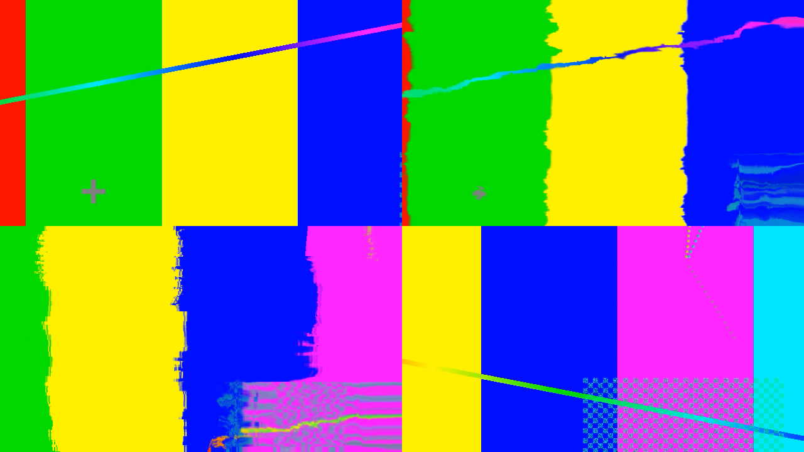

# Datamosh filter for OBS (Windows)

A datamosh video filter for OBS: the old picture gets dragged along by the motion instead of refreshing. Everything runs on the GPU; one DLL, no data folder.



## Install

1. Close OBS.
2. Download `datamosh-filter.zip` from [Releases](../../releases/latest) and unzip it into `C:\Program Files\obs-studio\` (it puts `datamosh-filter.dll` in `obs-plugins\64bit\`).
3. Open OBS, right-click a source > **Filters** > **+** under Effect Filters > **Datamosh**.

## Sliders

| Slider | What it does |
|---|---|
| Amount | Mix between the clean source (0) and the mosh (1) |
| Refresh | How fast the real picture leaks back in; 0 = never heals |
| Flow scale | Multiplies the motion; 0 freezes the smear |
| Block px | 0 = smooth melt; 4-32 = moves in hard macroblocks like a broken file |
| Steady flow | Blurs the motion so it swims instead of jitters |
| Auto reset every N s | Drops in a clean frame on a timer; 0 = off |
| Motion search range | How far it looks for movement each frame (x4 px); lower is cheaper |

**Clean frame (reset)** button, plus a hotkey *Datamosh: clean frame* under Settings > Hotkeys, snaps it back to the real picture: hit it, then move, to start a fresh mosh.

Flat single-colour areas have nothing to track, so they don't move; texture and edges smear best.

## Build (from Linux)

```bash
ZIG=zig OBS_SRC=path/to/obs-studio ./build.sh
```

Needs [zig](https://ziglang.org) 0.14 and an obs-studio source tree (only `libobs/` headers are used). `./build.sh linux` with `OBS_LIB=` also builds a `.so` for testing in Linux OBS.

## License

GPL-2.0-or-later, like OBS itself.
